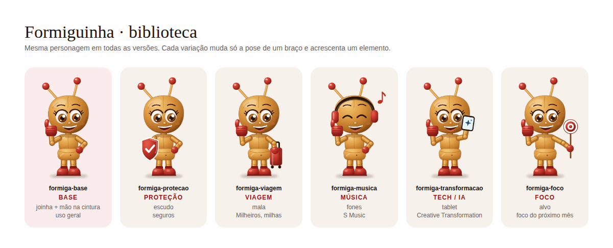

# Report Mensal · Creative Strategy PF

Template do report mensal da Creative Strategy PF (Marketing PF), construído como uma newsletter executiva em HTML de uma única página, distribuída pelo Outlook em formato `.eml`.

## Prévia do report


- **[Report de setembro 2026](reports/2026-09.html)**: arquivo editável do mês.
- **[Exemplo de .eml](examples/report-2026-09.eml)**: mensagem pronta para abrir no Outlook, gerada pela ferramenta do projeto.
- **[Modelo em branco](template/report-template.html)**: a mesma estrutura, só com placeholders.

## A história do report

O report é lido de cima para baixo como uma narrativa curta. **Cada projeto aparece uma vez só**, com contexto, resultado e peça juntos:

| | Seção | Pergunta que responde |
|---|---|---|
| 01 | **O mês em uma frase** | Qual foi o mês? A frase do mês e o projeto principal, com a peça e os números |
| 02 | **O que lançamos** | O que mais foi para o ar? 1 projeto em destaque com resultados + projetos compactos |
| 03 | **Creative X** | Como está a qualidade criativa? Score anterior → atual, em 3 segundos |
| 04 | **Creative Transformation** | O que estamos mudando na forma de criar? Projetos de IA e inovação |
| 05 | **O que aprendemos** | O que levamos do mês? Até 3 aprendizados com a ação |
| 06 | **Foco do próximo mês** | O que vem agora? A prioridade, em destaque |
| 07 | **Também vem aí** | O que está na agenda? Datas e projetos |

Os números, textos e imagens de setembro vêm do esboço original da área; as peças são recortes do esboço, em resolução baixa, e devem ser trocadas pelos arquivos originais. O que ainda não existe (score anterior do Creative X, aprendizados, foco, links dos vídeos, datas) aparece como placeholder identificado entre colchetes. Nenhum número foi inventado; as duas variações calculadas (`2,5x` e `+81%`) saem dos próprios números do esboço.

## Por que este projeto existe

O report da área era montado em formato de slide. O desafio foi transformá-lo em uma leitura única, vertical e editorial no canal em que ele é realmente lido: o Outlook. A solução precisava:

- caber em uma página contínua e curta, sem abas, menus ou repetição de informação;
- abrir da mesma forma no Outlook para Windows, no novo Outlook, no Outlook na Web e no celular;
- funcionar sem JavaScript, já que nenhum cliente de e-mail executa scripts;
- ser atualizada todo mês por uma pessoa com conhecimento básico de HTML, só com Bloco de Notas e navegador;
- reservar espaços para peças, imagens e vídeos de cada projeto.

## Base técnica

### HTML para e-mail

O report está em `reports/AAAA-MM.html`, um arquivo por mês. O layout usa tabelas e estilos inline, porque o Outlook para Windows desenha e-mails com o motor do Word e ignora CSS moderno como flexbox, grid e `position`.

Todo o conteúdo fica escrito diretamente no HTML. Comentários `EDITAR AQUI` marcam cada ponto que muda no mês, numerados de 01 a 12:

```text
01 MÊS · 02 FRASE DO MÊS · 03 PROJETO PRINCIPAL · 04 O QUE LANÇAMOS
05 CREATIVE X · 06 TRANSFORMATION · 07 IMAGENS · 08 VÍDEOS E LINKS
09 APRENDIZADOS · 10 FOCO · 11 AGENDA · 12 FORMIGUINHA
```

Blocos que se repetem (projeto em destaque, projeto compacto, projeto de Transformation) são delimitados por `INÍCIO BLOCO` e `FIM BLOCO` e podem ser duplicados ou removidos inteiros.

### Sistema visual

| Elemento | Regra |
|---|---|
| Tipografia | Georgia para frase do mês, títulos e números; Arial para rótulos e texto. As duas existem em qualquer computador |
| Hierarquia | rótulo (10 px, caixa alta) → título (Georgia) → número → etiqueta de variação → texto → legenda |
| Cantos | 8 px miniaturas · 14 px imagens e cartões · 20 px blocos grandes · pílula nas etiquetas |
| Vermelho `#9E1218` | Marca, numeração das seções, número principal e o bloco do Foco |
| Verde | Resultado positivo (`▲ +89%`, e `▼ −12%` quando cair é bom) e "implementado" |
| Âmbar | Previsto, pendente ou atenção |
| Grafite | Assinatura do Creative X (filetes e score, sem caixa pesada) |
| Petróleo | Assinatura do Creative Transformation |
| Creme | Superfície da abertura |

No Outlook para Windows os cantos aparecem retos; o layout e as cores continuam os mesmos.

### Formiguinha

A personagem da área tem uma versão base e variações com **um** elemento cada: proteção (seguros), viagem (Milheiros), música (S Music), tecnologia (Creative Transformation) e foco. Ela aparece no máximo 3 vezes por edição, em pontos fixos: no projeto principal, no Creative Transformation e no Foco do próximo mês.



As versões estão em `assets/formiguinha/`, com as regras de uso e de criação em [assets/formiguinha/README.md](assets/formiguinha/README.md).

### Ferramenta de .eml

O arquivo `tools/gerar-eml.html` abre no Edge ou no Chrome, sem instalação. Ele:

1. lê o report e as imagens da pasta do projeto;
2. lista pendências de conteúdo e problemas de compatibilidade com o Outlook;
3. embute as imagens na mensagem (anexos inline `cid:`);
4. gera um `.eml` que o Outlook abre como mensagem nova, pronta para envio.

As imagens vão dentro do e-mail porque imagens hospedadas no SharePoint não aparecem no Outlook, e imagens com link externo ficam bloqueadas até o leitor clicar em "Baixar imagens".

### Vídeos

Nenhuma versão do Outlook reproduz vídeo dentro do e-mail. O vídeo entra no projeto a que pertence, como miniatura clicável e um link **▶ Assistir**, que abre o Microsoft Stream.

## Estrutura do repositório

```text
report_mensal_st/
├── reports/                      # um report por mês (arquivo editado)
│   └── 2026-09.html              # report de setembro de 2026
├── template/
│   └── report-template.html      # modelo em branco, só com placeholders
├── assets/                       # imagens usadas pelos reports
│   ├── formiguinha/              # personagem: base + 5 variações (PNG)
│   │   └── svg/                  # fonte vetorial de cada versão
│   ├── icones/                   # ícones do Creative Transformation
│   └── 2026-09/                  # peças e miniaturas do mês
├── tools/
│   └── gerar-eml.html            # conferência e geração do .eml
├── examples/
│   └── report-2026-09.eml        # exemplo gerado pela ferramenta
└── docs/                         # documentação complementar
    ├── HOW_TO_EDIT.md            # atualização mensal em 10 passos
    ├── HOW_TO_EXPORT_EML.md      # o que é o .eml, como gerar e enviar
    ├── OUTLOOK_COMPATIBILITY.md  # o que funciona e o que evitar
    ├── TEST_CHECKLIST.md         # checklist antes de cada envio
    ├── ANALISE_E_DECISOES.md     # análise, auditorias e decisões de UX/UI
    ├── apresentacao-report-mensal.pptx / .pdf  # apresentação das mudanças
    ├── formiguinha-catalogo.png  # as versões da formiguinha
    └── preview-2026-09.jpg       # prévia usada neste README
```

Vídeos não ficam no repositório: eles são publicados no Stream, e o report leva apenas a miniatura e o link.

## Como usar

### Ver o report

Abra `reports/2026-09.html` no navegador. A página mostra o e-mail como ele será recebido. Para conferir a versão de celular, pressione F12 e depois Ctrl+Shift+M.

### Atualizar o mês

1. Copie o report do mês anterior para `reports/AAAA-MM.html`.
2. Crie a pasta `assets/AAAA-MM/` com as imagens do mês.
3. Pesquise `EDITAR AQUI` e atualize textos, números, imagens e links.
4. Revise no navegador.

O passo a passo completo, com exemplos de etiquetas, imagens, Creative X, Transformation e formiguinha, está em [docs/HOW_TO_EDIT.md](docs/HOW_TO_EDIT.md).

### Gerar e enviar o .eml

1. Abra `tools/gerar-eml.html` no Edge ou no Chrome.
2. Selecione a pasta principal do projeto.
3. Confira as pendências e a prévia.
4. Clique em **Baixar .eml** e abra o arquivo no Outlook.
5. Envie primeiro para você; depois, para a área.

Detalhes, alternativas para o novo Outlook e soluções de problemas: [docs/HOW_TO_EXPORT_EML.md](docs/HOW_TO_EXPORT_EML.md).

## Compatibilidade e limitações

- O layout foi escrito para o Outlook para Windows, o cliente mais restritivo; os demais clientes Outlook seguem o mesmo resultado.
- No celular, as colunas empilham onde o cliente aceita CSS de tela pequena. No Outlook para Windows, o layout é sempre o de 680 px.
- O HTML foi verificado no Chromium (computador e celular) e a estrutura do `.eml` foi validada, mas o envio ainda não foi testado em um Outlook real. Antes do primeiro envio, siga o [checklist de testes](docs/TEST_CHECKLIST.md).
- No novo Outlook e no Outlook para Mac, o `.eml` pode abrir como mensagem recebida; nesse caso, use **Encaminhar**.
- As peças de setembro foram recortadas do esboço e continuam em resolução baixa. Substitua pelos arquivos originais mantendo os mesmos nomes.
- A formiguinha foi redesenhada em vetor a partir da imagem de referência. É uma releitura em ilustração, não o arquivo original de marca.

A análise por recurso (imagens, fundos, fontes, GIF, SVG, vídeo, modo escuro) está em [docs/OUTLOOK_COMPATIBILITY.md](docs/OUTLOOK_COMPATIBILITY.md).

## Colaboração

O projeto utiliza GitHub para versionamento. Cada mês entra como um commit próprio, mantendo separados os reports, os assets, a ferramenta e a documentação:

```text
report: outubro 2026
assets: peças de outubro 2026
docs: atualizar guia de edição
tools: ajustar conferência do .eml
```

Os reports dos meses anteriores não são alterados depois do envio; eles formam o histórico da área.
