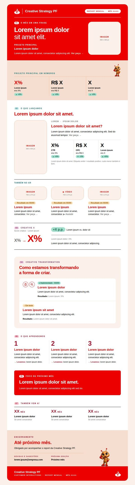
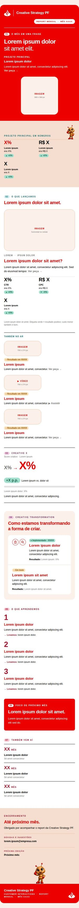

# Report Mensal · Creative Strategy PF

Modelo do report mensal da Creative Strategy PF (Customer Interactions): um e-mail executivo de uma página, enviado pelo Outlook, com peças e vídeos clicáveis. Ele é gerado a partir de **um arquivo de texto por mês**. Ninguém precisa editar HTML.

**Versão 3.1 (2026-10-12).** Histórico em [CHANGELOG.md](CHANGELOG.md).

<p>

&nbsp;

</p>

> Este repositório é um **modelo sem dados**: textos em **Lorem Ipsum**, números como **X%**, **R$ X** e **X p.p.**, e espaços marcados para imagens e links. Nada disso é resultado real. Os dados de cada mês ficam só no ambiente do banco (veja [Segurança dos dados](#segurança-dos-dados)).
>
> Identidade visual conforme o **Brand Guide Santander Brasil (maio/2026)**: paleta, tipografia, chama, cantos e tom de voz ([ARQUITETURA.md › Brand Guide](docs/ARQUITETURA.md#brand-guide-como-foi-aplicado-num-e-mail)).

---

## 1. O que é

Uma ferramenta simples para montar o report mensal:

- **você escreve** o conteúdo do mês num arquivo de texto (`dados/AAAA-MM.txt`);
- **uma página no navegador** (`gerar-report.html`) confere tudo, prepara as imagens e gera o e-mail;
- **o Outlook** abre o e-mail pronto para enviar.

## 2. Para que serve

Contar o mês da área em uma página, sempre na mesma ordem:

| | Seção | Pergunta que responde |
|---|---|---|
| 01 | **O mês em uma frase** | O que aconteceu? Qual foi o principal resultado? |
| 02 | **O que lançamos** | O que foi para o ar e o que evoluiu? |
| 03 | **Creative X** | Como está a qualidade criativa (antes → agora)? |
| 04 | **Creative Transformation** | O que estamos mudando na forma de criar? |
| 05 | **O que aprendemos** | O que os dados ensinaram? |
| 06 | **Foco do próximo mês** | Qual é a prioridade agora? |
| 07 | **Também vem aí** | O que está na agenda? |

## 3. Como funciona

```text
  VOCÊ EDITA                        ABRE NO NAVEGADOR          RESULTADO
  dados/AAAA-MM.txt  (texto)   ─┐
  assets/AAAA-MM/    (imagens)  ─┼──►  gerar-report.html  ──►  report-AAAA-MM.eml  → Outlook → enviar
  config/marca.txt   (raro)    ─┘     (confere e monta)  └──►  AAAA-MM.html        → reports/ (arquivo do mês)
```

- **Lorem Ipsum, `X` e `[INSERIR …]` = ainda não preenchido.** A página lista cada um, com a linha. Enquanto houver algum, só sai um RASCUNHO.
- **Imagens:** pode usar a original, em alta. A página reduz e recorta no formato de cada espaço.
- **Nada sai do computador:** a página só lê a pasta escolhida. Sem internet, sem servidor, sem instalação.

## 4. Estrutura de arquivos

```text
report_mensal_st/
├── gerar-report.html        ← ABRA ESTE para gerar o e-mail
├── report_backup.html       ← backup: o layout aprovado num arquivo só (veja docs/BACKUP.md)
├── README.md                ← este guia
├── CHANGELOG.md             ← histórico de versões
├── dados/                   ← O QUE VOCÊ EDITA TODO MÊS
│   └── MODELO.txt           modelo em branco (copie para AAAA-MM.txt)
├── assets/                  ← IMAGENS
│   ├── marca/               chama do Santander (oficial) e paleta de cores
│   ├── formiguinha/         a personagem (arquivo original)
│   ├── icones/              ícones do Creative Transformation
│   ├── fonts/               fontes Santander: CSS pronto, arquivos .otf entram aqui
│   └── fotos/               fotos do banco de imagens (só no ambiente do banco)
├── config/
│   └── marca.txt            fontes, cores, chama, formiguinha, links (raramente)
├── reports/                 página de cada mês, gerada (histórico, no ambiente do banco)
├── docs/                    guias
├── template/report.html     layout aprovado com {{campos}} (técnico, não editar)
├── tools/motor.js           motor que monta o e-mail (técnico, não editar)
└── tests/                   testes automáticos (técnico, opcional)
```

**Só três lugares mudam no dia a dia:** `dados/`, `assets/AAAA-MM/` e, de vez em quando, `config/marca.txt`.

## 5. Como abrir o projeto

1. Baixe ou copie a pasta do projeto inteira (com todas as subpastas), por um caminho **aprovado pela empresa**.
2. Abra a pasta no **PyCharm** (*File → Open* → escolha a pasta `report_mensal_st`). Passo a passo: [docs/GUIA_PYCHARM.md](docs/GUIA_PYCHARM.md).
3. Sem PyCharm, o Bloco de Notas também serve para editar os `.txt` (salve sempre em **UTF-8**).

## 6. Como visualizar o HTML

| Quero ver… | Faço… |
|---|---|
| O e-mail do mês | Abro `gerar-report.html` (dois cliques) → **Selecionar a pasta do projeto** → a **Prévia** aparece no fim da página, com os botões Computador e Celular |
| O layout aprovado, sem a ferramenta | Abro `report_backup.html` (dois cliques) |
| Um mês já enviado | Abro `reports/AAAA-MM.html` |

`template/report.html` sozinho **não** é o e-mail: ele tem `{{campos}}` que a ferramenta preenche.

## 7. Como utilizar o PyCharm

Abrir a pasta, editar o `.txt`, salvar, abrir no navegador, desfazer, usar o Git: tudo em [docs/GUIA_PYCHARM.md](docs/GUIA_PYCHARM.md). Nenhum plugin é obrigatório.

## 8. Como atualizar os resultados

Passo a passo completo: **[docs/COMO_ATUALIZAR_O_MES.md](docs/COMO_ATUALIZAR_O_MES.md)**. Em resumo:

1. Copie `dados/MODELO.txt` (ou o mês anterior) para `dados/AAAA-MM.txt`.
2. Troque o conteúdo de exemplo (Lorem Ipsum, `X%`, `[INSERIR …]`) pelos dados do mês. Não invente número para completar o layout.
3. Abra `gerar-report.html`, confira e gere o `.eml`.

Para escolher **quais** resultados destacar, use os prompts do Copilot: [docs/PROMPTS_COPILOT.md](docs/PROMPTS_COPILOT.md).

## 9. Como trocar as imagens

1. Coloque a imagem em `assets/AAAA-MM/` (nome simples, sem espaço nem acento).
2. No bloco da peça, escreva `imagem: nome-do-arquivo.jpg` e descreva a imagem em `descricao_imagem:`.
3. Se a parte importante for cortada, use `enquadramento: topo` (ou `baixo`, `esquerda`, `direita`, `centro`).

Fotos do banco de imagens aprovado: [assets/fotos/README.md](assets/fotos/README.md).

## 10. Como editar os textos

Tudo está em `dados/AAAA-MM.txt`, no formato `campo: valor`. Troque só o que vem depois dos dois-pontos. Para quebrar a linha num título, escreva `<br>`. Cada seção do arquivo começa com `EDITAR AQUI`.

Os textos não ficam no HTML: a página monta o HTML a cada geração, para o layout nunca quebrar. Para ver qual campo preenche cada trecho, procure `EDITAR AQUI` em `template/report.html`.

## 11. Como adicionar ou retirar seções

- **Retirar** um item (um número, um lançamento): apague o bloco inteiro no `.txt`.
- **Retirar uma seção inteira:** apague todos os blocos dela. A seção some e a numeração se ajusta sozinha.
- **Adicionar** um item: copie um bloco igual e troque o número (`[LANCAMENTO 3]`).
- **Uma seção nova, que não existe no modelo:** exige mudar o template. Veja [docs/FAQ.md](docs/FAQ.md#posso-criar-uma-seção-nova).

## 12. Como manter a identidade Santander

- Siga o **Brand Guide Santander Brasil (maio/2026)**. Ele é interno e **não** fica no repositório; peça a Marca.
- Fundo só em Branco, Lisboa, Rio ou Vermelho Santander. Sobre branco, títulos em vermelho e textos em preto. Paleta e regras: [assets/marca/README.md](assets/marca/README.md).
- Use só a **chama** oficial (sem o nome escrito), em branco sobre o vermelho.
- A formiguinha aparece **só duas vezes**: abertura e rodapé. Use sempre o arquivo original.
- Não use peças, logos ou fotos baixadas da internet.

## 13. Como utilizar a tipografia

Famílias do Brand Guide: **Santander Headline** Bold (títulos), **Santander Micro Text** (textos) e **Santander Condensed** (frase da capa). A Santander Script (voz do cliente) não é usada.

- **Quando os `.otf` chegarem:** copie para `assets/fonts/` e confira os nomes em `assets/fonts/fontes-santander.css` ([passo a passo](assets/fonts/README.md)).
- **Enquanto isso:** aparece a fonte Santander se estiver instalada no computador; senão, **Arial** (alternativa, não é a fonte oficial).
- **No e-mail (.eml):** vale sempre a fonte instalada; o Outlook não carrega arquivos de fonte.

Detalhes: [docs/GUIA_TIPOGRAFIA.md](docs/GUIA_TIPOGRAFIA.md).

## 14. Como testar o mobile

Na página `gerar-report.html`, seção **Prévia**, clique em **Celular**. Depois, o teste de verdade: envie o `.eml` para você e abra no celular. Checklist em [docs/TEST_CHECKLIST.md](docs/TEST_CHECKLIST.md).

## 15. Como verificar erros

A seção **Conferência** da página lista tudo, com o arquivo e a **linha**:

| Etiqueta | Significa | Impede? |
|---|---|---|
| **erro** | Algo quebrado (bloco com nome errado, imagem que não existe, link de rede) | Impede gerar |
| **falta** | Campo `[INSERIR …]` ou link ainda vazio | Só deixa gerar RASCUNHO |
| **aviso** / **para saber** | Confira, mas pode seguir | Não |

Erros comuns e soluções: [docs/FAQ.md](docs/FAQ.md).

## 16. Como exportar

Na página: **Baixar e-mail final (.eml)** (vai para o Outlook) e **Baixar página do mês (.html)** (guarde em `reports/`). Como abrir o `.eml` em cada Outlook: [docs/HOW_TO_EXPORT_EML.md](docs/HOW_TO_EXPORT_EML.md).

## 17. Como fazer backup

- **Do mês:** o `.html` do mês em `reports/` e o `dados/AAAA-MM.txt` já são o backup daquele mês.
- **Do projeto:** o Git guarda todas as versões. No ambiente do banco, faça *commit* e *push* depois de cada mês.
- **Do layout:** `report_backup.html`.

Tudo em [docs/BACKUP.md](docs/BACKUP.md).

## 18. Como recuperar versões anteriores

- Desfazer algo que acabou de digitar: **Ctrl+Z** no PyCharm.
- Voltar um arquivo para como estava antes (mesmo sem Git): PyCharm → botão direito no arquivo → **Local History → Show History**.
- Voltar para uma versão salva no Git: botão direito → **Git → Show History** → escolha a versão.

Passo a passo: [docs/BACKUP.md](docs/BACKUP.md#restaurar).

## 19. Problemas frequentes

| Problema | Solução |
|---|---|
| A página diz que não encontrou a pasta | Escolha a pasta **principal** (a que tem `dados`, `config`, `template`) |
| "imagem não encontrada" | Confira o nome do arquivo: maiúsculas, acentos e extensão |
| Acentos estranhos (`é`) | Salve o `.txt` em **UTF-8** (o PyCharm já salva assim) |
| Editei, mas a página não mudou | Salve e clique em **Selecionar a pasta** de novo |
| O botão "Baixar e-mail final" está cinza | Ainda há itens em **falta**. Preencha ou gere um RASCUNHO para teste |
| O `.eml` abre como mensagem recebida | Use **Encaminhar** ([HOW_TO_EXPORT_EML.md](docs/HOW_TO_EXPORT_EML.md)) |
| O e-mail corporativo bloqueou o `.zip` | É a política de segurança. Não tente contornar: use o caminho aprovado pela TI ([CORPORATE_SETUP.md](docs/CORPORATE_SETUP.md)) |

## 20. Perguntas e respostas

Mais de 25 perguntas, com respostas passo a passo: **[docs/FAQ.md](docs/FAQ.md)**.

---

## Segurança dos dados

- **Este repositório não tem dados reais.** Só o modelo (Lorem Ipsum e `X`), a chama, a formiguinha e os ícones.
- **Não ficam aqui:** o Brand Guide (interno), os `.otf` das fontes (proprietários) e as fotos do banco de imagens (licenciadas).
- **Resultados, peças e vídeos reais** ficam só no ambiente do banco (máquina do trabalho, SharePoint e repositório corporativo). Nunca no GitHub pessoal, no computador pessoal ou em ferramentas externas.
- **Fotos do banco de imagens** (Shutterstock, licenciadas para o banco) **não vão para o GitHub pessoal**: a pasta `assets/fotos/` está no `.gitignore`. Veja [assets/fotos/README.md](assets/fotos/README.md).
- O histórico antigo deste repositório tem versões com dados reais. Veja [docs/BACKUP.md › Histórico do Git](docs/BACKUP.md#histórico-do-git-e-dados-antigos).

## Documentação

| Guia | Para quê |
|---|---|
| [COMO_ATUALIZAR_O_MES.md](docs/COMO_ATUALIZAR_O_MES.md) | **Atualizar o mês** (comece por aqui) |
| [GUIA_PYCHARM.md](docs/GUIA_PYCHARM.md) | Usar o PyCharm do zero: abrir, editar, visualizar, Git |
| [FAQ.md](docs/FAQ.md) | Perguntas frequentes |
| [PROMPTS_COPILOT.md](docs/PROMPTS_COPILOT.md) | Prompts para analisar os resultados no Microsoft Copilot |
| [TEST_CHECKLIST.md](docs/TEST_CHECKLIST.md) | Checklist antes de enviar |
| [GUIA_TIPOGRAFIA.md](docs/GUIA_TIPOGRAFIA.md) | Fontes Santander, arquivos `.otf` e a alternativa |
| [BACKUP.md](docs/BACKUP.md) | Backup, versões e recuperação |
| [LINKS_SHAREPOINT_STREAM.md](docs/LINKS_SHAREPOINT_STREAM.md) | Qual link copiar, permissões, como testar |
| [CORPORATE_SETUP.md](docs/CORPORATE_SETUP.md) | Primeiro uso no banco e teste piloto |
| [HOW_TO_EXPORT_EML.md](docs/HOW_TO_EXPORT_EML.md) | O que é o `.eml`, como abrir e enviar |
| [OUTLOOK_COMPATIBILITY.md](docs/OUTLOOK_COMPATIBILITY.md) | O que funciona em cada Outlook |
| [ARQUITETURA.md](docs/ARQUITETURA.md) | Decisões técnicas, aplicação do Brand Guide e o que foi testado |

## Limitações conhecidas

- **Não testado num Outlook real** (este ambiente não tem Outlook). Layout, geração e estrutura do `.eml` foram verificados no Chromium (de 320 a 1440 px de largura) e com um leitor de e-mail padrão. Antes do primeiro envio, faça o **teste piloto** ([CORPORATE_SETUP.md](docs/CORPORATE_SETUP.md)).
- **Fontes Santander:** os `.otf` ainda não estão no projeto. O código já está pronto para recebê-los; até lá, aparece a fonte instalada ou Arial ([GUIA_TIPOGRAFIA.md](docs/GUIA_TIPOGRAFIA.md)).
- **Brand Guide em e-mail:** a margem de 8% e o Botão de Início "Começa agora" não foram aplicados (quebrariam a grade aprovada; o botão é um arquivo oficial não recebido). Detalhes em [ARQUITETURA.md](docs/ARQUITETURA.md#brand-guide-como-foi-aplicado-num-e-mail). **VALIDAR COM MARCA**.
- No Outlook para Windows, os cantos aparecem retos e o layout é sempre o de computador.
- Links, permissões e vídeo com som dependem do SharePoint/Stream do banco e só podem ser testados lá.

## Para quem for manter o código

- Testes do motor: `node tests/motor.test.js` (só Node.js).
- Teste da página de ponta a ponta, em 7 larguras de tela (320 a 1440 px): `node tests/ferramenta.e2e.js` (Node.js + Playwright).
- Nenhum dos dois é necessário para gerar o report.
- Commits por assunto: `report: outubro 2026`, `assets: …`, `docs: …`, `tools: …`. Registre mudanças de layout ou de motor no [CHANGELOG.md](CHANGELOG.md).
