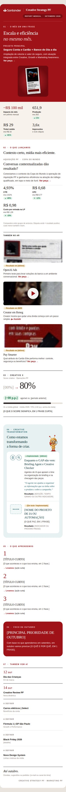

# Report Mensal · Creative Strategy PF

Newsletter executiva mensal da Creative Strategy PF (Marketing PF), enviada pelo Outlook. É um e-mail em HTML de uma página, com peças e vídeos clicáveis, gerado a partir de **um arquivo de texto por mês**.

<p>

&nbsp;

</p>

- **[Report de setembro 2026](reports/2026-09.html)**: a página do mês (abre no navegador).
- **[Exemplo de .eml](examples/report-2026-09-RASCUNHO.eml)**: rascunho pronto para abrir no Outlook.
- **[Dados de setembro](dados/2026-09.txt)**: o arquivo de texto que gerou tudo isso.

## Como funciona

```text
  VOCÊ EDITA                       CLICA                    RESULTADO
  dados/2026-10.txt  (texto)  ─┐
  assets/2026-10/    (imagens) ─┼──►  gerar-report.html  ──►  report-2026-10.eml  → Outlook → enviar
                                │     (abre no Edge)     └──►  2026-10.html       → reports/ (arquivo)
  config/marca.txt   (raro)    ─┘
```

**Você não edita HTML.** Escreve o conteúdo do mês num arquivo de texto, coloca as imagens numa pasta e clica em um botão. A página confere tudo, prepara as imagens e gera o `.eml`.

## Todo mês, em 6 passos

1. **Copie** `dados/2026-09.txt` → `dados/2026-10.txt`.
2. **Crie** `assets/2026-10/` e coloque as imagens do mês. Pode ser a original, em alta: a ferramenta reduz e recorta.
3. **Edite** `dados/2026-10.txt` no Bloco de Notas: troque o que vem depois de `campo:`.
4. **Cole os links** das peças (SharePoint) e dos vídeos (Stream) nos campos `link:`.
5. **Abra `gerar-report.html`**, selecione a pasta do projeto, confira e clique em **Baixar e-mail final (.eml)**.
6. **Abra o `.eml` no Outlook**, envie para você, confira e envie para a área.

Guia completo, para quem não programa: **[docs/HOW_TO_EDIT.md](docs/HOW_TO_EDIT.md)**.

## O arquivo de dados

Cada parte do e-mail é um bloco. Exemplo de um lançamento com vídeo:

```text
[LANCAMENTO 2]
status: Resultado em 28/09
status_cor: ambar
nome: Creator em Reneg
texto: Creator mostra que quitar uma dívida começa com um passo simples.
imagem: creator-reneg.jpg
descricao_imagem: Creator falando sobre renegociação de dívidas
tipo: video
link: https://empresa.sharepoint.com/:v:/s/creative/...
```

No e-mail, isso vira a miniatura com ▶, a etiqueta âmbar, o título, a frase e **▶ Assistir** no fim da frase. Clicar na miniatura ou no botão abre o vídeo no Stream.

**O mapa de assets do mês é o próprio arquivo:** cada projeto tem a imagem (`imagem`), o tipo (`tipo`) e o link (`link`) juntos no mesmo bloco.

## Interatividade

O report é um e-mail, não um site: nenhum Outlook executa JavaScript, toca vídeo dentro da mensagem ou abre janelas por cima. A interação confiável em e-mail é **clicar e abrir um destino**, e é ela que o report usa:

| Conteúdo | No e-mail | Ao clicar |
|---|---|---|
| Peça (imagem) | Miniatura + **Ver peça →** | Abre a peça grande no SharePoint, com login da empresa |
| Vídeo | Miniatura com ▶ + **▶ Assistir** | Abre o vídeo no Stream, com som, controles e legendas |
| Projeto | **Ver projeto →** / **Ver demonstração →** | Abre o documento, a apresentação ou a demonstração |

- Sem link, sem botão: a peça aparece normalmente.
- O botão fica no fim da frase do bloco, sem linha extra.

### Receitas rápidas

| Quero… | Faço… |
|---|---|
| **Adicionar uma imagem clicável** | Imagem em `assets/AAAA-MM/`; no bloco: `imagem: arquivo.jpg`, `tipo: peca`, `link: [link do SharePoint]` |
| **Adicionar um vídeo** | Capa do vídeo em `assets/AAAA-MM/` (sem ▶, a ferramenta desenha); `tipo: video`, `link: [link do Stream]` |
| **Trocar uma miniatura** | Troque o arquivo em `assets/AAAA-MM/` (mesmo nome) ou mude o nome em `imagem:` |
| **Inserir um link** | Cole depois de `link: `, numa linha só |
| **Usar o SharePoint** | Arquivo na pasta do time → Compartilhar → "Pessoas em [empresa]" → Copiar link |
| **Usar o Stream** | Vídeo no Stream (SharePoint) → Compartilhar → Copiar link (formato `/:v:/`) |
| **Testar** | Na página, seção "Teste os links" → Abrir; depois, envie para você e para alguém de outra equipe |
| **Gerar o .eml** | `gerar-report.html` → Selecionar pasta → Baixar e-mail final |
| **Ver se o link funciona para todos** | Peça para uma pessoa de **outra equipe** abrir (veja [LINKS_SHAREPOINT_STREAM.md](docs/LINKS_SHAREPOINT_STREAM.md)) |

## Pensado para um ambiente corporativo restrito

- **Sem dependência externa:** o e-mail não busca nada na internet. As imagens vão dentro do `.eml`, sem CDN, sem fonte baixada e sem serviço de terceiros.
- **Sem instalação:** a página de geração roda no Edge, a partir do arquivo, sem servidor e sem enviar dados para fora.
- **Links corporativos:** peças e vídeos abrem no SharePoint/Stream, com autenticação e permissões do Microsoft 365. A ferramenta recusa caminhos de rede e arquivos locais e avisa sobre links de download, de incorporação ou fora dos domínios aprovados.
- **Proteções contra erro:** pendências (`[texto entre colchetes]`) bloqueiam a versão final; só sai um RASCUNHO, com "[RASCUNHO]" no assunto.
- **Logo e fonte oficial configuráveis** num lugar só (`config/marca.txt`), com fallback seguro para quem não tem a fonte e para o Outlook para Windows.

Decisões e limitações: **[docs/ARQUITETURA.md](docs/ARQUITETURA.md)**. Primeiro uso no banco: **[docs/CORPORATE_SETUP.md](docs/CORPORATE_SETUP.md)**.

## A história do report

| | Seção | Pergunta que responde |
|---|---|---|
| 01 | **O mês em uma frase** | Qual foi o mês? A frase e o projeto principal, com peça e números |
| 02 | **O que lançamos** | O que mais foi para o ar? 1 projeto em destaque + até 3 compactos |
| 03 | **Creative X** | Como está a qualidade criativa? Anterior → atual |
| 04 | **Creative Transformation** | O que estamos mudando na forma de criar? |
| 05 | **O que aprendemos** | O que levamos do mês? |
| 06 | **Foco do próximo mês** | Qual é a prioridade agora? |
| 07 | **Também vem aí** | O que está na agenda? |

Cada projeto aparece **uma vez**. A formiguinha aparece no máximo 3 vezes: no projeto principal (com o tema dele), no Creative Transformation e no Foco. Catálogo: [assets/formiguinha/README.md](assets/formiguinha/README.md).

## Estrutura do projeto

```text
report_mensal_st/
├── gerar-report.html            ← ABRA ESTE para gerar o e-mail
├── dados/                       ← O QUE VOCÊ EDITA TODO MÊS
│   ├── 2026-09.txt              conteúdo de setembro
│   └── MODELO.txt               modelo em branco
├── assets/                      ← AS IMAGENS
│   ├── 2026-09/                 imagens do mês (uma pasta por mês)
│   ├── formiguinha/             a personagem: base + 5 variações
│   ├── marca/                   logo do Santander
│   └── icones/                  ícones do Creative Transformation
├── config/
│   └── marca.txt                logo, fontes, cores, modo das imagens, domínios (raramente)
├── reports/                     a página de cada mês, gerada (histórico)
├── examples/                    exemplo de .eml gerado
├── docs/                        guias
├── template/
│   └── report.html              layout aprovado com {{campos}} (técnico)
├── tools/
│   └── motor.js                 o motor de geração (técnico)
└── tests/                       testes automáticos (técnico, opcional)
```

## Documentação

| Guia | Para quê |
|---|---|
| [HOW_TO_EDIT.md](docs/HOW_TO_EDIT.md) | **Atualizar o mês** (comece por aqui) |
| [TEST_CHECKLIST.md](docs/TEST_CHECKLIST.md) | Checklist antes de enviar |
| [LINKS_SHAREPOINT_STREAM.md](docs/LINKS_SHAREPOINT_STREAM.md) | Qual link copiar, permissões, como testar |
| [CORPORATE_SETUP.md](docs/CORPORATE_SETUP.md) | Primeiro uso no banco: levar o projeto, fonte, SharePoint, teste piloto |
| [HOW_TO_EXPORT_EML.md](docs/HOW_TO_EXPORT_EML.md) | O que é o .eml, como abrir e enviar |
| [OUTLOOK_COMPATIBILITY.md](docs/OUTLOOK_COMPATIBILITY.md) | O que funciona em cada Outlook e os fallbacks |
| [ARQUITETURA.md](docs/ARQUITETURA.md) | Decisões técnicas e o que foi testado |
| [ANALISE_E_DECISOES.md](docs/ANALISE_E_DECISOES.md) | Histórico de design (das versões anteriores à atual) |

## Levar para a máquina do trabalho

No GitHub: **Code → Download ZIP**. Depois, extraia na máquina do trabalho e abra `gerar-report.html`. Use um caminho de transferência **aprovado pela empresa**: e-mails corporativos costumam bloquear `.zip`, `.html` e `.js`. Os dados reais do banco ficam só no ambiente corporativo. Detalhes em [CORPORATE_SETUP.md](docs/CORPORATE_SETUP.md#0-levar-o-projeto-para-a-máquina-do-trabalho).

## Limitações conhecidas

- **Não testado num Outlook real** (este ambiente não tem Outlook). A geração, o layout (computador e celular) e a estrutura do `.eml` foram verificados no Chromium e com um leitor de e-mail. Antes do primeiro envio, faça o **teste piloto** com outra pessoa.
- No Outlook para Windows, os cantos aparecem retos e o layout é sempre o de 680 px.
- Ao enviar, o Outlook para Windows reescreve o HTML. Confira o e-mail **recebido**, não só o rascunho.
- Links, permissões e vídeo com som dependem do SharePoint/Stream do banco e só podem ser testados lá.
- As peças de setembro são recortes do esboço, em baixa resolução. A formiguinha é uma releitura em ilustração, não o arquivo original de marca.

## Para quem for manter o código

- Testes do motor: `node tests/motor.test.js` (só Node.js).
- Teste da página de ponta a ponta: `node tests/ferramenta.e2e.js` (Node.js + Playwright).
- Commits por assunto: `report: outubro 2026`, `assets: peças de outubro`, `docs: ...`, `tools: ...`. Os meses já enviados não são alterados: `reports/` e `dados/` formam o histórico.
