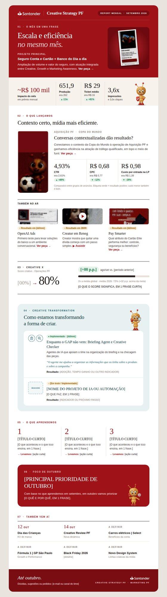

# Report Mensal · Creative Strategy PF

Template do report mensal da Creative Strategy PF (Marketing PF), construído como um e-mail HTML de uma única página e distribuído pelo Outlook em formato `.eml`.

## Prévia do report



- **[Report de setembro 2026](reports/2026-09.html)**: arquivo editável do mês.
- **[Exemplo de .eml](examples/report-2026-09.eml)**: mensagem pronta para abrir no Outlook, gerada pela ferramenta do projeto.

O report apresenta a visão geral do mês, os principais resultados, o Creative X, os destaques, as peças e vídeos, os aprendizados e os próximos passos, mantendo a identidade da área: vermelho, seções numeradas e a formiguinha.

## Por que este projeto existe

O report da área era montado em formato de slide. O desafio foi transformá-lo em uma experiência única, vertical e legível no canal em que ele é realmente lido: o Outlook. A solução precisava:

- caber em uma página contínua, sem abas, menus ou várias telas;
- abrir da mesma forma no Outlook para Windows, no novo Outlook, no Outlook na Web e no celular;
- funcionar sem JavaScript, já que nenhum cliente de e-mail executa scripts;
- ser atualizada todo mês por uma pessoa com conhecimento básico de HTML;
- reservar espaços para peças, imagens e vídeos do mês.

Os números de setembro vêm do esboço original da área. Informações que ainda não existem (score anterior do Creative X, aprendizados, links e acessos dos vídeos, peças) aparecem como placeholders identificados.

## Base técnica

### HTML para e-mail

O report está em `reports/AAAA-MM.html`, um arquivo por mês. O layout usa tabelas e estilos inline, porque o Outlook para Windows desenha e-mails com o motor do Word e ignora CSS moderno como flexbox, grid e `position`.

Todo o conteúdo fica escrito diretamente no HTML. Comentários `EDITAR AQUI` marcam cada ponto que muda no mês, numerados de 01 a 10:

```text
01 MÊS · 02 TÍTULO · 03 RESUMO · 04 MÉTRICAS · 05 CREATIVE X
06 SCORES · 07 IMAGENS · 08 VÍDEOS · 09 APRENDIZADOS · 10 LINKS
```

Blocos que se repetem (case, destaque, vídeo, aprendizado, item da agenda) são delimitados por `INÍCIO BLOCO` e `FIM BLOCO` e podem ser duplicados ou removidos inteiros.

### Ferramenta de .eml

O arquivo `tools/gerar-eml.html` abre no Edge ou no Chrome, sem instalação. Ele:

1. lê o report e as imagens da pasta do projeto;
2. lista pendências de conteúdo e problemas de compatibilidade com o Outlook;
3. embute as imagens na mensagem (anexos inline `cid:`);
4. gera um `.eml` que o Outlook abre como mensagem nova, pronta para envio.

As imagens vão dentro do e-mail porque imagens hospedadas no SharePoint não aparecem no Outlook, e imagens com link externo ficam bloqueadas até o leitor clicar em "Baixar imagens".

### Vídeos

Nenhuma versão do Outlook reproduz vídeo dentro do e-mail. O report usa miniatura, título, acessos, duração e um botão **ASSISTIR**, que abre o vídeo no Microsoft Stream.

## Estrutura do repositório

```text
report_mensal_st/
├── reports/                      # um report por mês (arquivo editado)
│   └── 2026-09.html              # report de setembro de 2026
├── template/
│   └── report-template.html      # modelo em branco, só com placeholders
├── assets/                       # imagens usadas pelos reports
│   ├── mascote/formiga.jpg       # a formiguinha (fixa)
│   ├── marca/creativex.jpg       # logo CreativeX (fixo)
│   ├── icones/                   # ícones reutilizáveis
│   └── 2026-09/                  # peças e miniaturas do mês
├── tools/
│   └── gerar-eml.html            # conferência e geração do .eml
├── examples/
│   └── report-2026-09.eml        # exemplo gerado pela ferramenta
└── docs/                         # documentação complementar
    ├── HOW_TO_EDIT.md            # atualização mensal em 10 passos
    ├── HOW_TO_EXPORT_EML.md      # o que é o .eml, como gerar e enviar
    ├── OUTLOOK_COMPATIBILITY.md  # o que funciona e o que evitar
    ├── TEST_CHECKLIST.md         # checklist antes de cada envio
    ├── ANALISE_E_DECISOES.md     # análise do esboço e decisões de UX/UI
    └── preview-2026-09.jpg       # prévia usada neste README
```

Vídeos não ficam no repositório: eles são publicados no Stream, e o report leva apenas a miniatura e o link.

## Como usar

### Ver o report

Abra `reports/2026-09.html` no navegador. A página mostra o e-mail como ele será recebido. Para conferir a versão de celular, pressione F12 e depois Ctrl+Shift+M.

### Atualizar o mês

1. Copie o report do mês anterior para `reports/AAAA-MM.html`.
2. Crie a pasta `assets/AAAA-MM/` com as imagens do mês.
3. Pesquise `EDITAR AQUI` e atualize textos, números, imagens e links.
4. Revise no navegador.

O passo a passo completo, com exemplos de troca de imagem, vídeo, Creative X e aprendizados, está em [docs/HOW_TO_EDIT.md](docs/HOW_TO_EDIT.md).

### Gerar e enviar o .eml

1. Abra `tools/gerar-eml.html` no Edge ou no Chrome.
2. Selecione a pasta principal do projeto.
3. Confira as pendências e a prévia.
4. Clique em **Baixar .eml** e abra o arquivo no Outlook.
5. Envie primeiro para você; depois, para a área.

Detalhes, alternativas para o novo Outlook e soluções de problemas: [docs/HOW_TO_EXPORT_EML.md](docs/HOW_TO_EXPORT_EML.md).

## Compatibilidade e limitações

- O layout foi escrito para o Outlook para Windows, o cliente mais restritivo; os demais clientes Outlook seguem o mesmo resultado.
- No celular, as colunas empilham onde o cliente aceita CSS de tela pequena. No Outlook para Windows, o layout é sempre o de 680 px.
- O HTML foi verificado no Chromium (computador e celular) e a estrutura do `.eml` foi validada, mas o envio ainda não foi testado em um Outlook real. Antes do primeiro envio, siga o [checklist de testes](docs/TEST_CHECKLIST.md).
- No novo Outlook e no Outlook para Mac, o `.eml` pode abrir como mensagem recebida; nesse caso, use **Encaminhar**.
- A formiguinha atual foi recortada do esboço, em baixa resolução. Substitua pelo arquivo original mantendo o nome `assets/mascote/formiga.jpg`.

A análise por recurso (imagens, fundos, fontes, GIF, SVG, vídeo, modo escuro) está em [docs/OUTLOOK_COMPATIBILITY.md](docs/OUTLOOK_COMPATIBILITY.md).

## Colaboração

O projeto utiliza GitHub para versionamento. Cada mês entra como um commit próprio, mantendo separados os reports, os assets, a ferramenta e a documentação:

```text
report: setembro 2026
assets: peças de setembro 2026
docs: atualizar guia de edição
tools: ajustar conferência do .eml
```

Os reports dos meses anteriores não são alterados depois do envio; eles formam o histórico da área.
