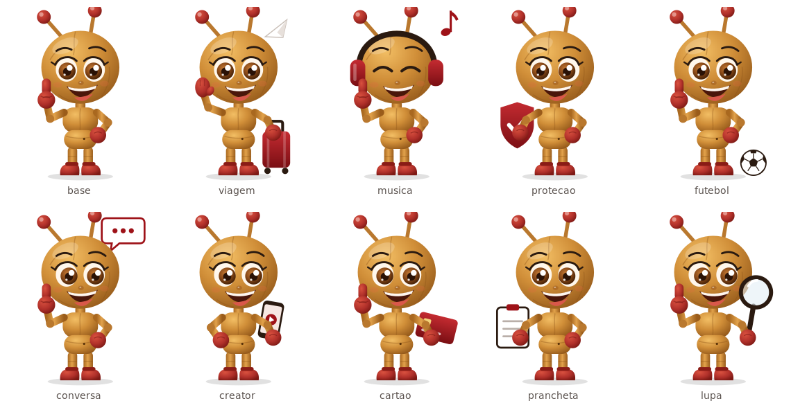

# Formiguinha · sistema de personagem

A formiguinha é a personagem da Creative Strategy PF. Ela acompanha os projetos do report: existe uma **versão base** e **variações temáticas** da mesma personagem.

## O que nunca muda

Todas as versões foram desenhadas a partir do mesmo arquivo e mantêm:

- corpo de madeira articulado, na mesma proporção (cabeça grande, tronco e quadril segmentados);
- olhos grandes castanhos com cílios, nariz pequeno e sorriso aberto;
- antenas de madeira com pontas vermelhas;
- luvas e botas vermelhas;
- paleta: madeira dourada, vermelho da marca e grafite.

## O que muda por projeto

Só **pose e um acessório**, sempre com poucos elementos:

| Arquivo | Acessório | Universo |
|---|---|---|
| `formiga-base.png` | joinha (pose da referência) | abertura, uso geral |
| `formiga-viagem.png` | mala de rodinhas + aviãozinho de papel | viagem, milhas (Milheiros) |
| `formiga-musica.png` | fones de ouvido + nota musical | música (S Music) |
| `formiga-protecao.png` | escudo com check | seguros, proteção |
| `formiga-futebol.png` | bola de futebol | esporte (Copa do Mundo) |
| `formiga-conversa.png` | balão de conversa | mídia conversacional, IA |
| `formiga-creator.png` | celular gravando | creators, vídeo |
| `formiga-cartao.png` | cartão | cartões, pagamentos |
| `formiga-prancheta.png` | prancheta com check | processos, briefing |
| `formiga-lupa.png` | lupa | Creative X, análise |

## Arquivos

- `*.png`: usados no e-mail. Fundo transparente, 160 px de largura (nítidos até 80 px na tela), ~8 KB cada.
- `svg/*.svg`: fonte vetorial de cada versão, para um designer ajustar ou criar novas variações.

## Como criar uma variação nova

1. Parta do `svg/formiga-base.svg` (ou da variação mais parecida).
2. Mude só a pose de um braço e acrescente **um** acessório ligado ao projeto, em vermelho, grafite ou branco.
3. Exporte em PNG transparente, 160 px de largura, e salve como `formiga-<tema>.png` (tema, não nome de campanha: `formiga-viagem`, não `formiga-milheiros`, para reaproveitar em outros meses).
4. Atualize a tabela acima e a tabela do passo 8 de `docs/HOW_TO_EDIT.md`.

As versões atuais foram desenhadas em vetor a partir da imagem de referência da formiguinha. É uma releitura em ilustração plana com volume, não o arquivo 3D original. Se a área tiver o arquivo original de marca, as variações podem ser refeitas a partir dele, mantendo os mesmos nomes de arquivo.
