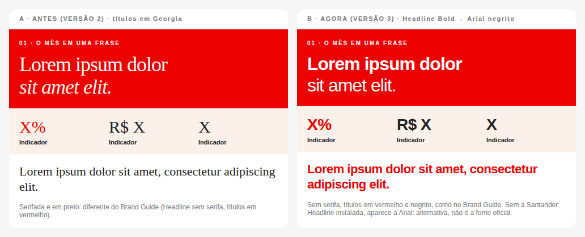

# Guia de tipografia

Como o report usa as fontes Santander, o que é oficial, o que é alternativa e como colocar os arquivos `.otf` quando eles chegarem.

> **Resumo:** o report já pede as fontes oficiais nas funções que o Brand Guide define. Os arquivos `.otf` ainda não estão no projeto: enquanto isso, quem não tiver a fonte instalada vê **Arial**, a alternativa do sistema (**não** é a fonte oficial). Quando os arquivos chegarem, basta copiá-los para `assets/fonts/`.

Referência: **Brand Guide Santander Brasil (maio/2026), seção 3.3 Tipografia**. O guia é um documento interno e **não** fica no repositório.

---

## 1. As 4 famílias oficiais

| Família | Função no Brand Guide | Pesos no guia | Uso no report |
|---|---|---|---|
| **Santander Headline** | Títulos de peso médio em ambientes digitais, documentos internos e aplicações menores | Light, Regular, **Bold** | Todos os títulos e números, em **Bold** |
| **Santander Micro Text** | Textos de apoio: qualquer mensagem que não seja título ou chamada | Light, **Regular**, SemiBold, **Bold**, ExtraBold | Textos em **Regular**; rótulos e subtítulos em **Bold** |
| **Santander Condensed** | Títulos e mensagens de impacto, na voz do banco (até 3 linhas) | Regular, **Bold**, Black | Frase do mês, na capa, em **Bold** |
| **Santander Script** | Títulos na voz do cliente: 1ª pessoa, caixa alta, até 4 palavras | Regular, Bold | **Não usada**: o report fala na voz do banco |

- O guia **não lista estilos itálicos**. Por isso o report não usa itálico em nenhum lugar (na versão anterior, o final da frase do mês e a despedida eram itálicos).
- O nome da família de texto é **Santander Micro Text** (não só "Micro").
- Quando a Condensed não cabe, o próprio guia manda usar a Headline. A lista da capa já faz isso: `'Santander Condensed', 'Santander Headline', Arial`.

### Hierarquia (guia, p. 48 a 50)

| Nível | Fonte | Tamanho em relação ao texto de apoio | No report |
|---|---|---|---|
| Título | Headline Bold | 300% | Frase do mês (36 px), títulos de seção (24 a 26 px) |
| Subtítulo | Micro Text Bold | 150% | Rótulos de seção, títulos de cartões (16 a 21 px) |
| Texto de apoio | Micro Text Regular | 100% | Textos (12 a 13 px) |

Os tamanhos do layout aprovado foram mantidos: num e-mail de 600 px, a proporção de 300% fica perto do tamanho da frase do mês. A hierarquia (título forte, subtítulo em negrito, texto regular) segue o guia.

### Cores do texto (guia, p. 38)

- Sobre **branco**: títulos em **vermelho** (#EC0000), textos de apoio em **preto**.
- Sobre **vermelho**: tudo em **branco**.

## 2. Onde cada fonte funciona

| Onde | Como a fonte chega | Resultado |
|---|---|---|
| **E-mail (.eml) no Outlook para Windows** | Só fontes **instaladas** no computador. O Outlook para Windows usa uma fonte só (`*_outlook_windows` em `config/marca.txt`) | **Arial** (até a TI confirmar a fonte Santander instalada em todos os computadores) |
| **E-mail em outros clientes** (novo Outlook, Web, Mac, celular) | Fontes **instaladas** no aparelho | Fonte Santander, se instalada; senão, Arial |
| **Prévia** da página `gerar-report.html` | Arquivos `.otf` de `assets/fonts/` | Fonte Santander, se o arquivo estiver na pasta; senão, a instalada ou Arial |
| **Página do mês** (`reports/AAAA-MM.html`) e **report_backup.html** | Arquivos `.otf` embutidos na página na hora de gerar | Igual à prévia, em qualquer computador |

Por que o e-mail não leva o arquivo de fonte: o Outlook para Windows ignora fontes de arquivo (`@font-face`), a rede do banco costuma bloquear e cada e-mail ficaria muito mais pesado. A ferramenta recusa `@font-face` no `.eml` de propósito.

## 3. Colocar os arquivos `.otf` (quando chegarem)

1. Baixe as fontes no **Portal da Marca** (link no Brand Guide) ou peça a Marca. Confirme que o uso está liberado para documentos internos.
2. No PyCharm, arraste os arquivos para a pasta **`assets/fonts/`**.
3. Abra `assets/fonts/fontes-santander.css`. Cada peso tem um bloco assim:
   ```css
   /* FONTE OFICIAL SANTANDER — INSERIR ARQUIVO .OTF AQUI (nome PROVISÓRIO) · USADA NO REPORT */
   @font-face {
     font-family: "Santander Headline";
     src: url("SantanderHeadline-Bold.otf") format("opentype");
     font-weight: 700;
     ...
   }
   ```
   Se o arquivo tiver outro nome (ex.: `Santander_Headline_Bd.otf`), troque **só** o nome dentro de `url("…")`. Não mude `font-family` nem `font-weight`: eles seguem o guia.
4. Abra `gerar-report.html` e selecione a pasta de novo. A **Conferência** mostra, em "Para saber", quantos arquivos foram encontrados.
5. Os arquivos **usados no report** hoje são: Headline **Bold**, Micro Text **Regular** e **Bold**, Condensed **Bold**. Os outros pesos estão declarados para uso futuro.

**Licença:** as fontes Santander são **proprietárias**. Os `.otf` podem ficar no repositório **corporativo**, se Marca autorizar, mas **não** no GitHub pessoal. **VALIDAR COM MARCA.**

Passo a passo: [assets/fonts/README.md](../assets/fonts/README.md).

## 4. A alternativa enquanto não há `.otf`

| Fonte oficial | Alternativa usada | Por quê | Diferença esperada |
|---|---|---|---|
| Santander Headline Bold | **Arial negrito** | Sem serifa e firme, como a Headline; existe em qualquer computador e no Outlook para Windows | A Arial é um pouco mais larga e mais "neutra"; não tem o "a" de um andar nem os cortes angulares da chama |
| Santander Micro Text | **Arial** | Sem serifa, boa leitura em tamanhos pequenos | Desenho mais genérico; espaçamento parecido |
| Santander Condensed Bold | Santander Headline → **Arial negrito** | O guia manda usar a Headline quando a Condensed não cabe | Sem a condensação: a frase da capa ocupa um pouco mais de largura |
| Santander Script | — | Não usada | — |

**A Arial não é a fonte oficial.** Ela só mantém a aparência sem serifa e em negrito do guia até os arquivos chegarem. Nenhum arquivo foi renomeado para parecer oficial.



A captura acima foi feita num ambiente sem Arial e sem Georgia: a Arial aparece como Liberation Sans (mesmas medidas) e a Georgia como Liberation Serif. No computador do banco, a aparência é a das fontes reais.

## 5. Kit de Marca do Canva

| Verificação | Resultado |
|---|---|
| Acesso à conta do Canva pela integração | Sim |
| Kit de Marca | **1 kit** encontrado |
| Fontes, pesos e estilos do kit | **Não disponíveis** pela integração (ela devolve só o identificador do kit) |
| Arquivos de fonte | **Não disponíveis**. Ver a fonte no Canva não dá o arquivo para usar fora do Canva. Nenhuma fonte foi extraída |

As famílias e os pesos deste guia vêm do **Brand Guide**, não do Canva.

## 6. Editar as fontes no PyCharm

| Quero… | Onde |
|---|---|
| Trocar a ordem ou a alternativa das fontes | `config/marca.txt`, bloco `[FONTES]` (`titulos`, `texto`, `impacto`) |
| Usar a fonte Santander no Outlook para Windows | `config/marca.txt`, `titulos_outlook_windows` e `texto_outlook_windows` (só com confirmação da TI) |
| Apontar para um arquivo `.otf` com outro nome | `assets/fonts/fontes-santander.css`, dentro de `url("…")` |
| Mudar o peso de um título | `template/report.html` (técnico). Não é necessário: os pesos já seguem o guia |

Nomes com espaço vão entre **aspas simples** em `config/marca.txt`: `'Santander Headline'`. Não use aspas duplas nem ponto e vírgula.

## 7. Verificar qual fonte está carregando

- **Prévia / página do mês** (Edge ou Chrome): botão direito num título → **Inspecionar** → aba **Computed** (Calculado) → **Rendered Fonts** mostra a fonte usada de verdade.
- **Conferência** da página `gerar-report.html`: em "Para saber", a linha "Fontes Santander: N de 13 arquivos encontrados".
- **Computador:** a fonte aparece na lista de fontes do Word? Então está instalada.
- **E-mail recebido no Outlook para Windows:** deve aparecer Arial. Se aparecer Times New Roman, o nome em `*_outlook_windows` não existe naquele computador.

## 8. Restaurar a tipografia

Cole no bloco `[FONTES]` de `config/marca.txt`:

| Versão | Valores |
|---|---|
| **3.0 (atual, Brand Guide)** | `titulos: 'Santander Headline', Arial, Helvetica, sans-serif` · `texto: 'Santander Micro Text', Arial, Helvetica, sans-serif` · `impacto: 'Santander Condensed', 'Santander Headline', Arial, Helvetica, sans-serif` · `titulos_outlook_windows: Arial` · `texto_outlook_windows: Arial` |
| **2.x (anterior)** | `titulos: Georgia, 'Times New Roman', serif` · `texto: Arial, Helvetica, sans-serif` · `titulos_outlook_windows: Georgia` · `texto_outlook_windows: Arial` (a versão 2 também tinha itálicos e títulos em preto no template) |

Ou recupere os arquivos pelo Git ([BACKUP.md](BACKUP.md#restaurar)).

## Pendências

- [ ] **Marca:** enviar os `.otf` (ou liberar o Portal da Marca) e confirmar os nomes oficiais dos arquivos e a licença para documentos internos.
- [ ] **TI:** a fonte Santander está instalada nos computadores? Se sim, em todos?
