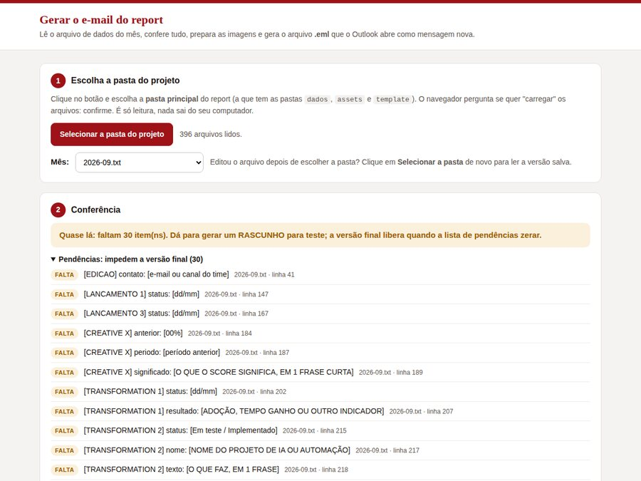

# Como atualizar o report todo mês

Guia para quem não programa. Você vai usar só três coisas:

| O quê | Para quê | Como abrir |
|---|---|---|
| **`dados/AAAA-MM.txt`** | Textos, números, imagens e links do mês | Bloco de Notas |
| **`assets/AAAA-MM/`** | As imagens do mês | Explorador de Arquivos |
| **`gerar-report.html`** | Conferir e gerar o e-mail (`.eml`) | Dois cliques (abre no Edge) |

Você **não** abre nem edita HTML.

---

## O mês em 6 passos

### 1. Copie o arquivo do mês anterior

Na pasta `dados`, copie `2026-09.txt`, cole e renomeie a cópia para o mês novo: `2026-10.txt`.

> Quer começar do zero? Copie `dados/MODELO.txt`. Ele vem com tudo entre colchetes para preencher.

### 2. Crie a pasta de imagens do mês

Em `assets`, crie a pasta `2026-10` e coloque as imagens do mês. Pode ser a imagem original, em alta: a ferramenta reduz e recorta sozinha.

Use nomes simples, sem espaço nem acento: `milheiros.jpg`, `s-music-video.jpg`.

### 3. Edite o arquivo do mês no Bloco de Notas

Clique com o botão direito em `dados/2026-10.txt` → **Abrir com → Bloco de Notas**.

**As regras são só estas:**

```text
campo: valor
```

- Troque só o que vem **depois dos dois-pontos**.
- Linhas que começam com `#` são explicações: não aparecem no e-mail.
- Os `[BLOCOS EM COLCHETES]` organizam o arquivo. Não mude o nome deles.
- Campo vazio = aquele elemento não aparece.
- Texto `[entre colchetes]` = **ainda falta preencher**. A ferramenta avisa.
- Para quebrar a linha num título, escreva `<br>`.

Comece pelo topo:

```text
[EDICAO]
mes: Outubro
ano: 2026
proximo_mes: Novembro
pasta_imagens: assets/2026-10
```

Depois, troque bloco por bloco (veja o [mapa](#mapa-cada-bloco-e-onde-ele-aparece) abaixo).

**Ao salvar:** Arquivo → Salvar. Se o Bloco de Notas perguntar a codificação, escolha **UTF-8** (senão os acentos estragam).

### 4. Coloque os links das peças e dos vídeos

Em cada peça, cole o link do SharePoint ou do Stream no campo `link:`. Qual link copiar: [LINKS_SHAREPOINT_STREAM.md](LINKS_SHAREPOINT_STREAM.md).

### 5. Gere o e-mail



1. Dois cliques em **`gerar-report.html`**.
2. Clique em **Selecionar a pasta do projeto** e escolha a pasta principal (a que tem `dados`, `assets`, `template`).
3. O mês mais recente é escolhido sozinho.
4. Leia a **Conferência**:
   - 🔴 **Erro**: algo impede gerar. Ao lado aparece o arquivo e a **linha** para corrigir.
   - 🟡 **Falta**: ainda tem texto entre colchetes ou link vazio. Dá para gerar um **RASCUNHO** para teste, mas a versão final só libera quando a lista zerar.
   - 🔵 **Aviso** e **Para saber**: confira, mas não impedem.
5. Corrigiu algo no Bloco de Notas? **Salve** e clique em **Selecionar a pasta** de novo, para a página ler a versão nova.
6. Na seção **Teste os links**, clique em **Abrir** em cada link.
7. Veja a **Prévia** (botões Computador e Celular).
8. Clique em **Baixar e-mail final (.eml)**. Clique também em **Baixar página do mês (.html)** e guarde esse arquivo na pasta `reports`.

### 6. Abra no Outlook e envie

1. Na pasta Downloads, dois cliques no `.eml`. O Outlook abre uma **mensagem nova**, com assunto e report prontos.
2. Envie primeiro **só para você**. Confira no computador e no celular.
3. Abra o `.eml` de novo, coloque os destinatários e envie.

Antes de enviar, siga o [checklist](TEST_CHECKLIST.md).

---

## Mapa: cada bloco e onde ele aparece

| Bloco no arquivo | Onde aparece no e-mail |
|---|---|
| `[EDICAO]` | Selo do mês na capa ("REPORT MENSAL · OUTUBRO 2026"), "Foco de…", "Até…", assunto e contato no rodapé |
| `[ABERTURA]` | **01** · a frase do mês na capa vermelha (`frase` na 1ª linha, `frase_final` em itálico na 2ª) e o texto da caixa de entrada (`previa`) |
| `[PROJETO PRINCIPAL]` | **01** · nome, resumo e peça na capa; formiguinha na faixa dos números |
| `[NUMERO 1]` a `[NUMERO 4]` | **01** · os números da abertura (o 1º fica em vermelho) |
| `[LANCAMOS]` | **02** · o título da seção "O que lançamos" |
| `[DESTAQUE]` | **02** · o projeto em destaque (peça vertical, título, texto e nota) |
| `[RESULTADO 1]` a `[RESULTADO 3]` | **02** · os 3 números do projeto em destaque |
| `[LANCAMENTO 1]` a `[LANCAMENTO 3]` | **02** · "Também no ar": até 3 projetos com miniatura |
| `[CREATIVE X]` | **03** · score anterior → atual, barra e frase |
| `[TRANSFORMATION]` e `[TRANSFORMATION 1]` a `[3]` | **04** · Creative Transformation |
| `[APRENDIZADO 1]` a `[3]` | **05** · O que aprendemos |
| `[FOCO]` | **06** · o bloco vermelho do foco do próximo mês |
| `[AGENDA 1]` a `[AGENDA 6]` | **07** · Também vem aí |

**Regra do report:** cada projeto aparece **uma vez**. O projeto principal não se repete em "O que lançamos".

Se uma seção inteira ficar sem itens (por exemplo, nenhum `[TRANSFORMATION 1]`), ela some e a numeração das seções se ajusta sozinha.

---

## Receitas prontas

### Trocar uma peça

1. Coloque a imagem nova em `assets/2026-10/` (ex.: `milheiros.jpg`).
2. No arquivo do mês, procure (Ctrl+F) o bloco da peça, por exemplo `[LANCAMENTO 1]`.
3. Troque:
   ```text
   imagem: milheiros.jpg
   descricao_imagem: Peça de Milheiros com avião e mala
   tipo: peca
   link: https://empresa.sharepoint.com/:i:/s/creative/E...
   ```
4. Gere o e-mail de novo.

`descricao_imagem` é o texto que aparece no lugar da imagem quando ela não carrega, e o que leitores de tela leem. Descreva a peça em poucas palavras.

### Colocar um vídeo

1. Publique o vídeo no Stream (pasta do SharePoint do time) e copie o link de compartilhamento.
2. Salve uma imagem do vídeo (um quadro ou a capa) em `assets/2026-10/`. **Não** desenhe o ▶: a ferramenta desenha.
3. No bloco do projeto:
   ```text
   imagem: s-music-capa.jpg
   descricao_imagem: Cantora no palco do S Music
   tipo: video
   link: https://empresa.sharepoint.com/:v:/s/creative/E...
   ```
4. No e-mail aparecem o ▶ sobre a miniatura e o texto "▶ Assistir".

### Inserir ou trocar um link

Procure o bloco e cole o link depois de `link: `, numa linha só. Para tirar o botão, deixe `link:` vazio.

### Escolher o texto do botão

| Escreva em `tipo:` | Aparece no e-mail |
|---|---|
| `peca` | Ver peça → |
| `video` | ▶ Assistir |
| `projeto` | Ver projeto → |
| `demo` | Ver demonstração → |

### Números e etiquetas verdes

```text
[NUMERO 2]
valor: 651,9
titulo: Produção
detalhe: era 262
variacao: 2,5x
```

- `variacao` vira a etiqueta verde com ▲. Começando com `-` (ex.: `-12%`), a seta vira ▼: use quando cair é bom (custo, CPC).
- Resultado em atenção? Acrescente `variacao_cor: ambar`.
- Sem etiqueta? Deixe `variacao:` vazio.
- Valor curto: até ~10 caracteres (`~R$ 100 mil`, `4,93%`, `3,6x`).

### Status dos lançamentos ("Resultado em 28/09")

```text
status: Resultado em 28/09
status_cor: ambar
```

`ambar` = previsto, aguardando. `verde` = no ar, implementado.

### Creative X

```text
anterior: 72%
atual: 80%
variacao:
periodo: ago/set vs. jun/jul
```

Com `anterior` e `atual` em %, a ferramenta calcula a variação (`+8 p.p.`) e a barra sozinha. Deixe `variacao:` vazio.

### Tirar um item (um lançamento, um número, um aprendizado)

Apague o bloco inteiro, do `[NOME DO BLOCO]` até a linha antes do próximo bloco. As colunas se reorganizam sozinhas.

### Acrescentar um item

Copie um bloco igual, cole embaixo e troque o número: `[LANCAMENTO 3]`. Limites: 4 números, 3 resultados, 3 lançamentos, 3 projetos de Transformation, 3 aprendizados e 6 itens de agenda.

### Formiguinha do projeto principal

```text
formiguinha: viagem
```

| Escreva | Versão |
|---|---|
| `base` | joinha (uso geral) |
| `protecao` | escudo (seguros) |
| `viagem` | mala (Milheiros) |
| `musica` | fones (S Music) |
| `transformacao` | tablet (IA) |
| `foco` | alvo |

As formiguinhas do Transformation e do Foco são fixas. Detalhes em [assets/formiguinha/README.md](../assets/formiguinha/README.md).

### Agenda

```text
[AGENDA 1]
data: 12 OUT
titulo: Dia das Crianças
detalhe: KV de marca
```

`data` com dia e mês (`12 OUT`) aparece grande e em vermelho. Qualquer outro texto (`A DEFINIR`) aparece em cinza.

---

## Erros comuns

| A ferramenta diz | O que fazer |
|---|---|
| "Linha sem ':'" | Na linha indicada falta o `:` depois do nome do campo, ou é um comentário sem `#` no começo |
| "Bloco [...] desconhecido" | O nome entre colchetes foi alterado. Use os nomes do mapa acima |
| "imagem não encontrada" | O nome do arquivo está diferente. Confira maiúsculas, acentos e a extensão (`.jpg` / `.png`) |
| "o campo ... é obrigatório" | Preencha o campo indicado |
| "Campo ... não existe ... ignorado" | Nome de campo digitado errado (ex.: `titlo`). Corrija o nome |
| "é um caminho de rede" | Você colou `\\servidor\...` ou `C:\...`. Use o link do SharePoint |
| Acentos estranhos (`é`) no e-mail | O arquivo foi salvo em outra codificação. No Bloco de Notas: Salvar como → Codificação **UTF-8** |
| A página não mudou depois de editar | Salve o arquivo e clique em **Selecionar a pasta** de novo |

## O que mudar raramente

| Arquivo | Quando | Guia |
|---|---|---|
| `config/marca.txt` | Logo, fonte oficial, cores, modo das imagens, domínios de link | Comentários do próprio arquivo e [CORPORATE_SETUP.md](CORPORATE_SETUP.md) |
| `template/report.html` | Mudar o **layout** (precisa de alguém que saiba HTML de e-mail) | [ARQUITETURA.md](ARQUITETURA.md) |
| `tools/motor.js` | Nunca, no dia a dia | — |
